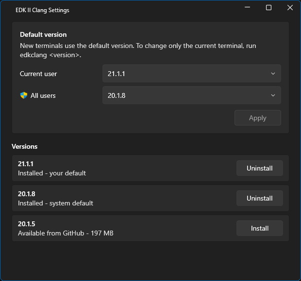

# EDK II Clang for Windows

EDK II Clang is the Clang toolchain for building [EDK II](https://github.com/tianocore/edk2) firmware on Windows,
packaged as a simple installer. Each release is an exact copy of the MSYS2 package group
[mingw-w64-clang-x86_64-toolchain](https://packages.msys2.org/groups/mingw-w64-clang-x86_64-toolchain) as it was on
one day. Nothing is rebuilt or patched, and installing it does not need MSYS2 or `pacman`.

Releases are named after the LLVM version they contain, such as EDK II Clang 20.1.8.

## Why MSYS2

An EDK II build compiles more than firmware. The BaseTools include C programs, such as GenFw, GenFv, and GenFfs, that
run on the build machine, so the toolchain must also be able to build Windows applications.

The prebuilt Windows binaries from the LLVM project rely on the Windows SDK and the Visual Studio build tools to build
Windows applications. That is a good choice for Windows application development, but for firmware development the full
Windows SDK is overkill. The lightweight [Mingw-w64](https://www.mingw-w64.org/) Windows runtime covers the relatively
simple needs of the BaseTools with much less overhead. MSYS2's `clang64` environment pairs Clang with Mingw-w64, so a
single toolchain builds both the BaseTools and the firmware.

## Why snapshots

MSYS2 is a rolling release. `pacman` always installs the newest packages, and there is no simple way to install the
toolchain as it was on an earlier date. Two developers who set up their machines a month apart can end up with
different compilers, and a build server set up today will not match one set up last year. New compiler versions bring
new warnings, and EDK II treats warnings as errors, so firmware that builds on one machine can fail on another with no
change to its code.

EDK II Clang takes snapshots of MSYS2 as it evolves and turns each one into a release that can be installed again
whenever it is needed. This gives everyone in the TianoCore community the same baseline for developing with Clang on
Windows:

- **The same compiler everywhere.** Developers and build machines that install the same release get the same files,
  so a build that works on one machine works on the others.
- **Old build environments can be recreated.** The compiler that built a firmware release can be installed again
  later, to rebuild that release or to fix a bug in it.
- **Upgrades happen when you choose.** A project moves to a newer compiler when it is ready, not when MSYS2 publishes
  one.

The rest of EDK II Clang is built around these goals. Releases install side by side, so one machine can have every
compiler needed for the projects that its users are developing. The `edkclang` command picks one for a shell or a build
script, and the EDK II Clang Settings program makes compiler version management easy.

## What a release contains

Everything the `mingw-w64-clang-x86_64-toolchain` group installs into MSYS2's `clang64` folder: Clang and the Clang
tools, LLD, LLDB and the other LLVM tools, the Mingw-w64 headers and C runtime, libc++, and `mingw32-make`. The
[group's page](https://packages.msys2.org/groups/mingw-w64-clang-x86_64-toolchain) lists every package.

EDK II also needs Python and NASM, and some platforms need iASL. They are not part of the toolchain and are managed separately.

Alongside the toolchain, the installer adds:

- The `edkclang` command, which lists the installed versions and switches between them.
- EDK II Clang Settings, a program that changes the default version and installs and uninstalls versions.
- The `BASETOOLS_MINGW_PATH` environment variable, which tells EDK II which version to use.

## Getting started

1. Download `EdkClangSetup-<version>.exe` from the
   [releases of tianocore/edk2-edkrepo](https://github.com/tianocore/edk2-edkrepo/releases). The tags of EDK II Clang
   releases start with `edkclang-v`.
2. Run it. It installs the toolchain into `C:\edk2-clang\<version>`.
3. Open a new command prompt and build EDK II with Clang:

   ```cmd
   cd edk2
   edksetup.bat Rebuild Mingw-w64
   build -t CLANGPDB -a X64 -p MdeModulePkg\MdeModulePkg.dsc
   ```

   `Mingw-w64` makes `edksetup.bat` use the toolchain that `BASETOOLS_MINGW_PATH` points at. `Rebuild` builds the
   BaseTools with it, which is only needed the first time.

The installer needs 64-bit Windows 10 version 1607 or later, or Windows Server 2016 or later, and administrator rights.

## Use cases

### Give a team the same compiler

Choose a release and name its version in the project's build instructions. Everyone who installs that release gets
the same compiler, so a warning or a code generation problem that one developer sees, every developer sees.

Run `edkclang` to see which versions a machine has. It lists the installed versions and marks the one the current
shell uses with `*`. EDK II Clang Settings also lists the versions published on GitHub, and can install one that is
missing. See [Manage versions with EDK II Clang Settings](#manage-versions-with-edk-ii-clang-settings).

### Recreate an older build environment

To rebuild or fix firmware that was released with an older compiler, install the release it was built with. Each
version installs into its own folder, such as `C:\edk2-clang\20.1.8` and `C:\edk2-clang\22.1.1`, so installing an
older release leaves the newer ones alone. Switch to it with `edkclang`, build, and switch back.

Installing a release does remove older releases of the same major version (installing 22.2.1 removes 22.1.3), because
LLVM only makes incompatible changes in major releases. To keep both, choose *Keep* on the installer's options page or
pass `/KeepOldVersions`. See [Older versions of the same major release](#older-versions-of-the-same-major-release).

### Work on projects that need different compilers

Install every version your projects need. `BASETOOLS_MINGW_PATH` decides which one a shell uses, and `edkclang`
changes it:

| Command | Effect |
|---------|--------|
| `edkclang 22.1.1` | Switches this shell to 22.1.1. |
| `edkclang 22` | Switches this shell to the newest installed 22.x.y. |
| `edkclang 22.1.1 --global` | Also makes 22.1.1 your default in new shells. |
| `edkclang 22.1.1 --system` | Also makes it the default for every user. Windows asks for administrator approval. |

Switching one shell does not affect other shells, so two firmware builds can use different versions at the same time.
`edkclang` can run before or after `edksetup.bat`: if `edksetup.bat` already put the old version's folder in `PATH`
and `CLANG_BIN`, `edkclang` replaces it there too.

`edkclang` works in cmd.exe, Windows PowerShell, PowerShell 7, and Git Bash. See
[The edkclang command](#the-edkclang-command) for every option.

### Manage versions

EDK II Clang Settings application manages Clang versions. It shows the default version for you and for all
users and lets you change either one. It also lists the installed versions next to the ones published on GitHub, so
you can install or uninstall a version with one click.



Start it from the Start menu (or run `C:\edk2-clang\tools\EdkClangSettings.exe`).

- **Default version.** Picks the version that new terminals use, for the current user or for all users.
  Nothing is changed until you click **Apply**.
  Changing the user default writes your own `BASETOOLS_MINGW_PATH`, which overrides the system default for you.
  Changing the system default asks for administrator approval.
- **Versions.** Lists the installed versions, and the versions that are published on GitHub but not installed.
  The list comes from the [releases](https://github.com/tianocore/edk2-edkrepo/releases) page.

Installing a version downloads `EdkClangSetup-<version>.<build>.exe` and verifies it before running it. If older versions of the
same major release are installed, it asks whether to remove them.

Installing or uninstalling can replace or delete EDK II Clang Settings application itself, so it closes while the installer or
uninstaller runs and then reopens afterward (if it still exists.)

### Choose the compiler in a build script

A platform's build script can select the compiler the platform was validated with, instead of depending on the
machine's default. Ask for a major version, such as `edkclang 22`, to accept any 22.x.y and get the newest one
installed, or for a full version, such as `edkclang 22.1.1`, to require exactly that one. The exit code is not 0 if no
installed version matches.

In a batch file, use `call`:

```bat
call edkclang 22
if errorlevel 1 (
  echo This platform needs EDK II Clang 22: https://github.com/tianocore/edk2-edkrepo/releases
  exit /b 1
)
call edksetup.bat Mingw-w64
```

In a PowerShell script:

```powershell
edkclang 22
if ($LASTEXITCODE -ne 0) { throw 'This platform needs EDK II Clang 22.' }
```

From any other language, run `edkclang --json`, choose a version from the list, and set `BASETOOLS_MINGW_PATH` to its
`path` in the script's own environment. In Python, to use the newest 22.x.y installed:

```python
import json, os, subprocess, sys

result = subprocess.run(["cmd", "/c", "edkclang", "--json"], capture_output=True, text=True)
versions = json.loads(result.stdout).get("versions", [])
matches = [v for v in versions if v["complete"] and v["version"].startswith("22.")]
if not matches:
    sys.exit("This platform needs EDK II Clang 22.")
newest = max(matches, key=lambda v: [int(n) for n in v["version"].split(".")])
os.environ["BASETOOLS_MINGW_PATH"] = newest["path"]
```

See [JSON output](#json-output) for every field.

### Set up build servers

Install unattended with `/Silent`, which shows no UI and exits with 0 on success and 1 on failure:

```cmd
EdkClangSetup-22.1.1.0.exe /Silent /KeepOldVersions
```

Run one installer for each version the server needs. `/KeepOldVersions` stops a newer release from removing an older
one of the same major version. A new version only becomes the system default if there is none yet or it is newer than
the current one, so build jobs should select their version with `edkclang` instead of relying on the default.

Remove a version the same way:

```cmd
C:\edk2-clang\EdkMingwInstaller.exe /Uninstall /Version 20.1.8 /Silent
```

See [Installer command-line options](#installer-command-line-options) for every option and where the logs are written.

Windows containers are fully supported, so the same commands work in a Dockerfile. Use a Windows Server Core base
image, because Nano Server does not include the .NET Framework that the installer needs.

### Try a newer compiler

Install the new release next to the current one. Switch one shell to it, build, and fix any new warnings while other
shells keep using the current version. When the project is ready, update the version its build scripts and
instructions name, and make the new version your default with `edkclang <version> --global` or EDK II Clang Settings.

### Ship a customized installer

An organization can rebrand the installer, install into a different folder, and run its own steps during install and
uninstall with a plugin DLL, without changing this repository. See [Vendor customization](#vendor-customization).

## Reference

### Installer command-line options

`EdkClangSetup-<version>.exe` extracts itself to a temporary folder and starts `EdkMingwInstaller.exe` with the same
command line. Options are case-insensitive and accept `/`, `-`, or `--` as the prefix.

| Option        | Description |
|---------------|-------------|
| *(none)*      | Interactive install: shows a welcome screen, then a progress window. |
| `/Passive`    | Shows only the progress window. No prompts. |
| `/Silent`     | No UI. Writes progress to the parent console. Implies `/Passive`. |
| `/KeepOldVersions` | With `/Passive` or `/Silent`, keeps older versions of the same major release instead of uninstalling them. |
| `/Uninstall`  | Uninstalls instead of installing. Combine with `/Passive` or `/Silent` for unattended removal. |
| `/Version <version>` | With `/Uninstall`, the version to remove, for example `/Version 20.1.8`. Optional when only one version is installed. |

The exit code is `0` on success and `1` on failure. Logs are written to `%TEMP%\EdkMingwInstaller-<GUID>.log`.

### What gets installed where

```text
C:\edk2-clang\
  20.1.8\               one folder per version, holding that version's bin, lib, and so on
  22.1.1\
  tools\                edkclang.cmd, edkclang-core.exe and EdkClangSettings.exe with its DLLs; on the system PATH
  EdkMingwInstaller.exe the uninstaller, shared by all versions
```

The installer also adds an **EDK II Clang Settings** shortcut to the all-users Start menu.

The installation directory is writable only by administrators.

The uninstaller on disk is only replaced when the installer being run has a higher engine version
(the `[installer]` version in `version_numbers.ini`), so installing an older package does not downgrade it.

### Choosing the default version

The default version is what `BASETOOLS_MINGW_PATH` points at in new shells.

- **Interactive install.** If more than one version will be installed, an options page lets you pick the
  default from a drop-down list. It is skipped when there is only one version.
- **`/Passive` and `/Silent`.** No page is shown. The new version becomes the default only if no default
  is set or it is newer than the current default.

### Older versions of the same major release

LLVM only makes incompatible changes in major releases, so an installed version with the same major number
as the installer's and a lower version (22.1.3 is installed and the installer carries 22.2.1) is normally
redundant.

- **Interactive install.** The options page offers *Uninstall* (the default) or *Keep*. Choosing
  *Uninstall* also removes those versions from the default version list.
- **`/Passive` and `/Silent`.** The older versions are uninstalled unless `/KeepOldVersions` is given.

The old version is removed after the new one is installed. Its folder and Programs and Features entry are
deleted, and any default `BASETOOLS_MINGW_PATH` (system or user) that selected it moves to the new version.
If the folder cannot be deleted, the installer logs it and still succeeds; remove it later with
`/Uninstall /Version <version>`. A different major version, such as 20.1.8, and any newer version are not removed.

### Upgrading from an older installer

If `C:\edk2-clang\bin\clang.exe` exists, the installer moves everything into `C:\edk2-clang\<version>`,
points `BASETOOLS_MINGW_PATH` at the new location, and replaces the old uninstall entry. Close any program that
is using clang first, or the move is rolled back with an error.

Command prompts that were open during the upgrade still have the old location on their `PATH`. Run
`edkclang <version>` in them, or open a new one.

Do not run an installer from before the addition of the side-by-side feature after upgrading. It deletes the whole
`C:\edk2-clang` folder, including every version.

### Uninstalling

Uninstall from **Settings > Apps** (or **Programs and Features**), where each version has its own entry,
or run the following:

```cmd
C:\edk2-clang\EdkMingwInstaller.exe /Uninstall /Version 20.1.8
```

Uninstalling a version removes that version's folder and its Programs and Features entry. Every
user's `BASETOOLS_MINGW_PATH` (including users who are not logged in) that pointed at it is moved to
the newest version that is left, or removed if no version is left.

When the last version is removed, the uninstaller also removes the `edkclang` command, EDK II Clang Settings, the
`PATH` entry, itself, and the installation directory if nothing else is in it.

### The edkclang command

`edkclang` is installed in `C:\edk2-clang\tools`, which is on the system `PATH`. Open a new command
prompt or PowerShell window after the first install.

| Command | Effect |
|---------|--------|
| `edkclang` | Lists the installed versions. `*` marks the version this shell uses. |
| `edkclang 22.1.1` | Switches this shell to 22.1.1: sets `BASETOOLS_MINGW_PATH`, and rewrites the old version's folder in `PATH` and `CLANG_BIN` if `edksetup` already put it there. |
| `edkclang 22` | Switches to the newest installed 22.x.y. `edkclang 22.1` works the same way for 22.1.x. Combines with `--global` and `--system`. |
| `edkclang 22.1.1 --global` | Also makes 22.1.1 your default in new shells. Needs no administrator rights. |
| `edkclang 22.1.1 --system` | Also makes it the default for every user. Windows asks for administrator approval. |
| `edkclang --clear-global` | Removes your own default, so new shells use the system default. This shell is not changed. Can also be added to a version switch. |
| `edkclang ... --json` | Prints the result of any of the above as JSON, for scripts. |

Both `--global` and `--system` can be given together. A `--global` default overrides the system
default. `--clear-global` cannot be combined with `--global`.

#### JSON output

With `--json`, `edkclang` prints one JSON object and nothing else. It always has `exitCode` (0 means
success) and `messages` (the error or usage text, if any); a failure also has `error`. The other fields
depend on the command:

| Command | Fields |
|---------|--------|
| list | `command` (`"list"`), `root`, `versions` (each with `version`, `path`, `complete`, `thisShell`, `userDefault`, `systemDefault`), `shellPath`, `userDefaultPath`, `systemDefaultPath`, `warnings` |
| switch | `command` (`"switch"`), `version`, `path`, `shellChanged`, `userDefaultSet`, `userDefaultCleared`, `systemDefaultSet` |
| `--clear-global` | `command` (`"clear-global"`), `userDefaultCleared` (`false` if there was nothing to remove), `systemDefault`, `systemDefaultVersion` |

For example, on a machine with two versions installed, where this shell uses 21.1.1 and the system default is
20.1.8, `edkclang --json` prints the following (formatted here for reading.) The versions are
listed newest first.

```json
{
  "exitCode": 0,
  "command": "list",
  "root": "C:\\edk2-clang",
  "versions": [
    {"version": "21.1.1", "path": "C:\\edk2-clang\\21.1.1", "complete": true, "thisShell": true, "userDefault": false, "systemDefault": false},
    {"version": "20.1.8", "path": "C:\\edk2-clang\\20.1.8", "complete": true, "thisShell": false, "userDefault": false, "systemDefault": true}
  ],
  "shellPath": "C:\\edk2-clang\\21.1.1",
  "userDefaultPath": null,
  "systemDefaultPath": "C:\\edk2-clang\\20.1.8",
  "warnings": [],
  "messages": []
}
```

The process exit code is the same as `exitCode`, so `edkclang --json | ConvertFrom-Json` works in
PowerShell and the exit code can still be checked.

## Building

### Prerequisites

- Visual Studio 2015, 2017, 2019, or 2022 with the .NET desktop development workload.
- Python 3, available through the `py` launcher.

### Making a new snapshot

A snapshot is the `clang64` folder of an MSYS2 installation that has the `mingw-w64-clang-x86_64-toolchain` group
installed and nothing else in `clang64`.

1. Update MSYS2 (`pacman -Syu`), then install the group with `pacman -S mingw-w64-clang-x86_64-toolchain`.
2. Compress the `clang64` folder into a 7-Zip archive with `clang64` as its top-level folder, split into 90 MB
   volumes so that each file stays under GitHub's 100 MB limit. Name it after the snapshot date:

   ```cmd
   7za a -v90m clang64_snapshot2025_7_16.7z C:\msys64\clang64
   ```

3. Replace the archive in `Vendor/` with the new `.7z.001`, `.7z.002`, ... files. Keep only one snapshot there,
   because the build extracts every `clang64_snapshot*.7z.001` it finds.
4. Build the installer. No version file needs to change.

### Build the installer

```cmd
cd build-scripts
build_installer.bat
```

The result is placed at `dist\EdkClangSetup-<version>.exe`. Besides `EdkMingwInstaller.exe` and the
`clang64` toolchain, the package carries a `tools` folder (`edkclang-core.exe`, `edkclang.cmd`,
`EdkClangSettings.exe` and the DLLs it loads) and `edkclang.sh`. The installer copies the `tools` folder as is
into the installation directory. It is a separate folder so the installer does not find the DLLs that Settings
loads from its own folder; the installer embeds its own copies. The LLVM version is read from the packaged
`clang.exe`.

### Versioning

The LLVM version is not configured anywhere. The build runs the packaged `clang.exe --version` and uses
the result. It names the install folder and the setup program, and it is recorded as the
`AssemblyInformationalVersion`.

The installer engine version is set in [version_numbers.ini](build-scripts/version_numbers.ini):

```ini
[installer]
  version=2.0.0
```

- `[installer] version` is the version of the install and uninstall engine, stamped as
  `AssemblyFileVersion`. Raise it whenever the uninstaller, `edkclang`, Settings, or the install logic changes.
  A newer engine replaces the uninstaller already on disk; an older one never does.

Both final versions get `.<BUILD_NUMBER>` appended when the `BUILD_NUMBER` environment variable is set
(for example, in CI), and `.0` otherwise.

### Clean

```cmd
cd build-scripts
cln.bat
```

### Updating other dependencies

- **WPF-UI and related assemblies:** Update the pinned versions and SHA-512 hashes in
  [fetch_wpfui.py](lib/fetch_wpfui.py), then run `py -3 lib\fetch_wpfui.py`. The script downloads the
  NuGet packages, checks their hashes, extracts the `net462` assemblies, and regenerates
  `versions.txt` and `THIRD-PARTY-NOTICES.txt`. Commit the updated files.
- **PowerShell reference assembly:** `lib/PowerShellStandard` holds a compile-time-only reference used by
  `edkclang-core.exe`. See its [README](lib/PowerShellStandard/README.txt).

## Vendor customization

Vendors can rebrand and extend the installer without changing this repo. To do so, place a .NET
assembly named `TianoCore.EdkMingwInstaller.VendorCustomizer.dll` next to `EdkMingwInstaller.exe`.
At startup, the installer loads the first exported type that has an attribute named
`EdkRepoInstallerVendorCustomizerAttribute`. The installer binds to the plugin's members
dynamically. See [VendorCustomizer.cs](EdkMingwInstaller/VendorCustomizer.cs) for the full contract.

The plugin can provide:

- **Branding:** `ProductName`, `InstallerName`, `VendorLogo` / `VendorLogoDark`,
  `WelcomeSplash` / `WelcomeSplashDark`. The dark variants are optional.
- **Install metadata:** `ProductCode`, `InstallationDirectory`, `UninstallDisplayName`,
  `UninstallPublisher`, `UninstallDisplayVersion`, `UninstallEstimatedSize`. Without a plugin, the
  installer reports the real size of each version's folder as `EstimatedSize`.
- **Lifecycle hooks:** `PreInstallEvent`, `PreCopyEvent`, `FinishInstallEvent`,
  `PreUninstallEvent`, `FinishUninstallEvent`. A hook can call the failure callback it receives
  to abort the operation.
- **Integration:** `WriteToInstallLog` and `SilentMode` are set by the installer.

Each customized build must use its own `ProductCode`, which must be a GUID. Add that code to
`InstallerStrings.KnownVendorProductCodes` so that different variants detect and replace each other.

Because versions install side by side:

- `PreInstallEvent` and `PreUninstallEvent` receive and return the installation directory
  (`C:\<InstallationDirectory>`), not a version folder. A version is installed in
  `<installation directory>\<version>`.
- `PreUninstallEvent` and `FinishUninstallEvent` also receive the version being uninstalled, such as
  `22.1.8`: `PreUninstallEvent(installationDirectory, version, failure)` and
  `FinishUninstallEvent(version, failure)`. The version is empty if no version is installed.
- A Programs and Features entry is written per version. Its key name is a version 5 UUID derived from the
  `ProductCode` and the version, and it records the original code in the `EdkClangBaseProductCode` value.
  The entry for `ProductCode` itself is only written by older installers.
- `UninstallDisplayVersion`, if the plugin provides it, is used for the version being installed.

## License

Unless otherwise noted, the source code in this repository is licensed under
[BSD-2-Clause-Patent](https://spdx.org/licenses/BSD-2-Clause-Patent.html).

Third-party components have their own licenses:

- WPF-UI and the Microsoft `System.*` assemblies are MIT licensed. See
  [THIRD-PARTY-NOTICES.txt](lib/WPF-UI/THIRD-PARTY-NOTICES.txt).
- The 7-Zip SFX module and `7za.exe` are © Igor Pavlov, under the GNU LGPL.
- UPX and rcedit are distributed under their own licenses.
- The MSYS2 `clang64` toolchain includes LLVM, Mingw-w64, and other packages, each under its own license.
